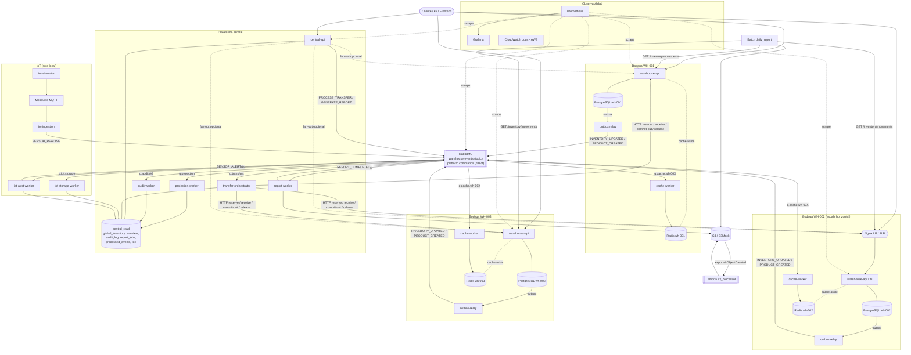
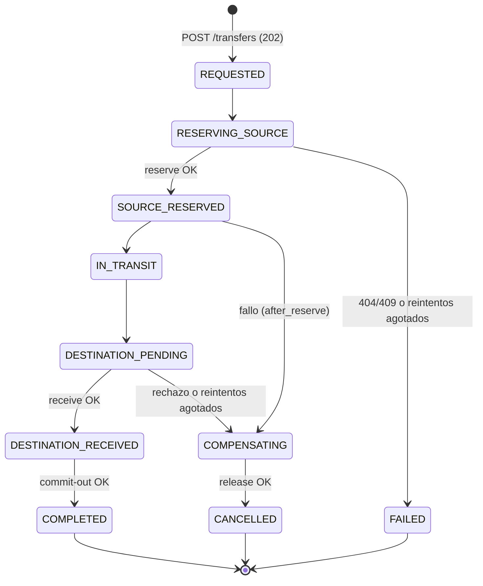
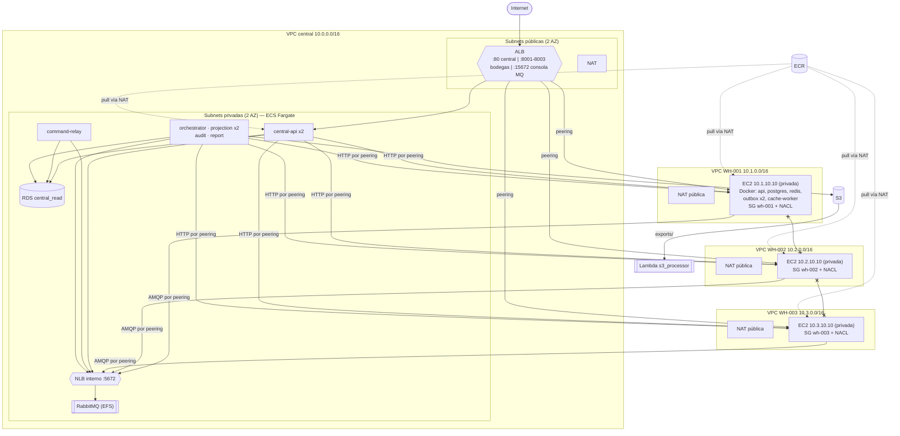

# Arquitectura final — Warehouse Cloud Platform

Documento del Entregable 1 (README §31). Describe lo que **existe en el repositorio**. Las decisiones están justificadas en `docs/adr/`.

## 1. Diagrama de la solución (Mermaid)



## 2. Diagrama ASCII

```text
                              Clientes / Frontend / k6
                                       |
        +---------------+--------------+---------------+---------------+
        |               |                              |               |
   [ WH-001 API ]  [ Nginx LB / ALB ]             [ WH-003 API ]  [ central-api ]
        |               |                              |               |
        |        [ WH-002 API x N ]                    |               |
        |               |                              |               |
  PG wh-001+Redis   PG wh-002+Redis               PG wh-003+Redis   central_read (PG)
   | outbox          | outbox                      | outbox              ^   ^   ^
   v                 v                             v                     |   |   |
 +-------------------------------------------------------------------+   |   |   |
 |                        RabbitMQ                                   |   |   |   |
 |  warehouse.events (topic) --> q.cache.wh-00X --> cache-worker->Redis  |   |   |
 |                           --> q.projection ---> projection-worker ----+   |   |
 |                           --> q.audit (#) ----> audit-worker -------------+   |
 |                           --> q.iot.storage --> iot-storage-worker ---------+  |
 |                           --> q.iot.alerts ---> iot-alert-worker --------------+
 |  platform.commands (direct) --> q.transfers --> transfer-orchestrator --HTTP--> APIs de bodega
 |                             --> q.reports ----> report-worker --> S3 (reports/)
 |  (cada cola Q tiene Q.retry (TTL 5 s -> Q) y Q.dlq)               |
 +-------------------------------------------------------------------+
                                  ^
  Sensores -> Mosquitto (MQTT QoS1) -> iot-ingestion ----------------+

  S3: reports/  warehouses/  exports/ --(evento)--> Lambda --> processed/ | rejected/
  Batch (cron / compose profile): bodegas -> consolidado diario -> S3 + batch_runs
  Observabilidad: logs JSON + X-Correlation-ID | Prometheus -> Grafana | CloudWatch Logs (AWS)
```

## 3. Componentes

| Componente | Responsabilidad | Tecnología | Escala | Estado |
|---|---|---|---|---|
| `warehouse-api` (x3 bodegas) | CRUD productos, inventario, movimientos, comandos de saga, Cache Aside, escribe outbox | FastAPI, SQLAlchemy, Redis | Horizontal por bodega (WH-002 con 3 réplicas locales; en AWS una EC2 por bodega con `--workers` configurable) | Stateless (estado en PG/Redis) |
| PostgreSQL por bodega | Fuente de verdad de la bodega; `inventory`, `movements`, `outbox`, `processed_commands` | PostgreSQL 15 | Vertical (o réplicas de lectura, propuesta) | Con estado |
| Redis por bodega | Caché de lecturas de inventario (TTL 30 s, `allkeys-lru`, 128 MB) | Redis 7 | Una instancia por bodega | Con estado efímero (descartable) |
| `outbox-relay` (x3) | Publica filas `outbox` pendientes a RabbitMQ | Python, pika | 1 por bodega (`SKIP LOCKED` permite más) | Sin estado (estado en `outbox`) |
| `cache-worker` (x3) | Invalidación asíncrona (estrategia B) | Python, redis-py | 1 por bodega; subir con la cola | Sin estado |
| RabbitMQ | Broker: exchanges `warehouse.events` (topic) y `platform.commands` (direct), colas con retry/DLQ | RabbitMQ 3.13 | Instancia única (clúster = producción) | Con estado (colas durables) |
| `central-api` | Crea transferencias, consultas globales (readmodel/fanout), reportes, auditoría | FastAPI | Horizontal (stateless; publisher AMQP por proceso) | Stateless |
| `transfer-orchestrator` | Saga orquestada; avanza `transfers` y llama a las bodegas | Python worker (`prefetch=1`) | Horizontal con cuidado: `FOR UPDATE` serializa por transferencia | Estado en `central_read.transfers` |
| `projection-worker` | Mantiene `global_inventory` y `warehouse_status` | Python worker | Horizontal (idempotente + `FOR UPDATE`) | Estado en `central_read` |
| `audit-worker` | Guarda todos los eventos en `audit_log` | Python worker | Horizontal | Estado en `central_read` |
| `report-worker` | Genera snapshots JSON a S3, `report_jobs` | Python worker, boto3 | Horizontal por cola | Estado en `report_jobs` + S3 |
| `central_read` (PG) | Read model, transfers, audit, jobs, `processed_events`, tablas IoT | PostgreSQL 15 | Vertical | Con estado |
| S3 (S3Mock local) | Reportes, exports, processed/rejected | S3 | Administrado | Con estado |
| Lambda `s3_processor` | Valida/normaliza archivos `exports/` | Python (boto3) | Administrado por AWS | Sin estado |
| Batch `daily_report` | Consolidado diario de movimientos | Python (imagen `batch`) | Ejecución puntual | Sin estado (`batch_runs`) |
| Nginx LB / ALB | Reparte tráfico entre réplicas | nginx 1.25 / AWS ALB | Administrado (ALB) | Sin estado |
| IoT: Mosquitto, simulador, `iot-ingestion`, `iot-storage-worker`, `iot-alert-worker` | Telemetría MQTT -> eventos -> almacenamiento y alertas | Mosquitto 2, Python | Workers horizontales (idempotentes) | Estado en `sensor_*` |
| Prometheus + Grafana + exporters | Métricas y dashboard | Prometheus 2.54, Grafana 11.2 | Local | Con estado (TSDB) |
| Frontend | UI (perfil `frontend`) | HTML/JS + nginx | Estático | Sin estado |

## 4. Consistencia fuerte vs eventual

| Dónde | Modelo | Mecanismo |
|---|---|---|
| Movimiento de inventario dentro de una bodega (stock + movimiento + outbox + `processed_commands`) | **Fuerte** (ACID local) | `SELECT ... FOR UPDATE` + un solo COMMIT; `CHECK quantity >= 0` |
| Lecturas de inventario vía Redis | **Eventual acotada** (<= TTL 30 s en el peor caso) | Cache Aside + invalidación A (síncrona) y B (asíncrona) |
| Cambios de la bodega -> eventos | **At-least-once**, eventual | Outbox + relay (~1 s) |
| Read model `global_inventory` | **Eventual** (retraso de outbox + cola + proyección) | `projection-worker` idempotente; campo `stale` |
| Transferencias entre bodegas | **Eventual** con compensación (Saga) | Estados persistidos + comandos idempotentes |
| Estado de la transferencia (`transfers`) | **Fuerte** en `central_read` | Transición + `history` en un commit por paso |
| Auditoría | Eventual, completa por idempotencia | `audit_log` ON CONFLICT DO NOTHING |
| Lecturas IoT | Eventual; orden por sensor | `sequence_number` + `processed_events` |
| Consulta global en `mode=fanout` | Fresca (lectura directa) pero **parcial** si una bodega falla | HTTP en paralelo, timeout 2 s |

## 5. Flujos clave

### 5.1 Movimiento de inventario -> outbox -> eventos -> proyección/caché/auditoría

```mermaid
sequenceDiagram
    autonumber
    participant C as Cliente
    participant A as warehouse-api
    participant P as PostgreSQL bodega
    participant R as Redis
    participant O as outbox-relay
    participant Q as RabbitMQ
    participant CW as cache-worker
    participant PR as projection-worker
    participant AU as audit-worker
    participant CD as central_read

    C->>A: POST /inventory/movements (X-Correlation-ID)
    A->>P: BEGIN; SELECT FOR UPDATE; UPDATE inventory; INSERT movement; INSERT outbox
    A->>P: COMMIT (una sola transaccion)
    A->>R: DEL claves id y sku (estrategia A, errores ignorados)
    A-->>C: 200 / 201
    loop cada 1 s
        O->>P: SELECT outbox WHERE published_at IS NULL FOR UPDATE SKIP LOCKED
        O->>Q: publish INVENTORY_UPDATED (inventory.updated.wh-001, confirms)
        O->>P: UPDATE published_at
    end
    Q->>CW: q.cache.wh-001
    CW->>R: DEL claves (estrategia B)
    Q->>PR: q.projection
    PR->>CD: ya procesado? upsert global_inventory si occurred_at >= last_event_at + processed_events (1 tx)
    Q->>AU: q.audit (#)
    AU->>CD: INSERT audit_log ON CONFLICT DO NOTHING
```

Fallos: Redis caído -> la API sigue (fallback a PG); RabbitMQ caído -> el evento queda en `outbox`; worker caído -> el mensaje espera en la cola; duplicado -> `processed_events` / ON CONFLICT.

### 5.2 Transferencia entre bodegas (Saga orquestada)



```mermaid
sequenceDiagram
    autonumber
    participant C as Cliente
    participant CA as central-api
    participant Q as RabbitMQ
    participant OR as transfer-orchestrator
    participant S as API bodega origen
    participant D as API bodega destino

    C->>CA: POST /transfers (Idempotency-Key opcional)
    CA->>CA: INSERT transfers (REQUESTED) + COMMIT
    CA->>Q: PROCESS_TRANSFER (transfer.process)
    CA-->>C: 202 {transfer_id, PROCESSING}
    Q->>OR: q.transfers
    OR->>S: POST /transfers/{id}/reserve  (quantity -> reserved)
    OR->>D: POST /transfers/{id}/receive  (crea producto si no existe; quantity += n)
    OR->>S: POST /transfers/{id}/commit-out (reserved -= n)
    Note over OR: cada transicion = commit + TRANSFER_STATUS_CHANGED
    OR-->>Q: transfer.status.completed
    Note over OR,S: si receive falla -> POST /release (compensacion) -> CANCELLED
```

Cada comando en la bodega es idempotente por `(transfer_id, step)` (`processed_commands`).

### 5.3 Reporte asíncrono

1. `POST /reports {"report_type":"inventory_snapshot"}` inserta `report_jobs(PROCESSING)` y publica `GENERATE_REPORT` (`report.generate`); responde `202 {job_id}`. Sin broker: error 503.
2. `report-worker` (`q.reports`) construye el snapshot desde `global_inventory`, lo sube a `s3://$S3_BUCKET/reports/{yyyy}/{mm}/{job_id}.json`, marca `COMPLETED` con `s3_key` y publica `REPORT_COMPLETED`.
3. El cliente consulta `GET /reports/jobs/{job_id}`. Errores de S3 5xx/timeout => reintento (retry TTL); al agotar => `FAILED` + DLQ.

### 5.4 IoT

`iot-simulator` -> MQTT `warehouses/{WH}/sensors/{id}` (QoS 1) -> Mosquitto -> `iot-ingestion` (valida) -> `SENSOR_READING` (`iot.reading.<wh>`) -> `q.iot.storage` (dedupe por `event_id`, descarte por `sequence_number`, tabla `sensor_readings`) y `q.iot.alerts` (umbral superado -> `SENSOR_ALERT` + `sensor_alerts`). Todo pasa también por `q.audit`.

## 6. Diagrama de despliegue AWS (Learner Lab)

Una VPC por bodega + VPC central, peering hub-and-spoke (ADR-015). Las bodegas no tienen ruta entre ellas.



Estado real en AWS: **sí** APIs de bodega (EC2), central y workers (ECS), RabbitMQ (ECS + EFS), RDS, S3, Lambda, ALB/NLB y CloudWatch Logs; **no** IoT, Prometheus/Grafana, ni planificador del Batch (solo local). Detalles en `docs/aws-deployment.md`, ADR-015 y ADR-016.

## 7. Topología local (Docker Compose)

Perfiles (`infrastructure/compose/docker-compose.yml`, generado por `generate_compose.py`): sin perfil = bodegas (db, redis, api; `wh-002-lb` y `wh-002-api-1`); `lb` = `wh-002-api-2/3`; `events` = RabbitMQ + outbox + cache-workers; `central`; `batch`; `obs`; `iot`; `frontend`. Puertos: central 8000, WH-001 8001, WH-002 (LB) 8002, WH-003 8003, frontend 8080, RabbitMQ UI 15672, Prometheus 9090, Grafana 3000, S3Mock 9000, Mosquitto 1883.
